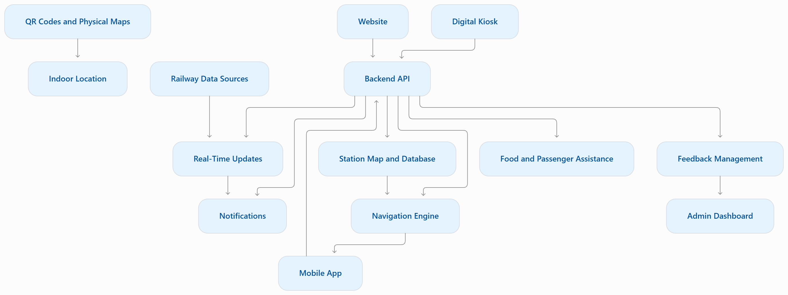
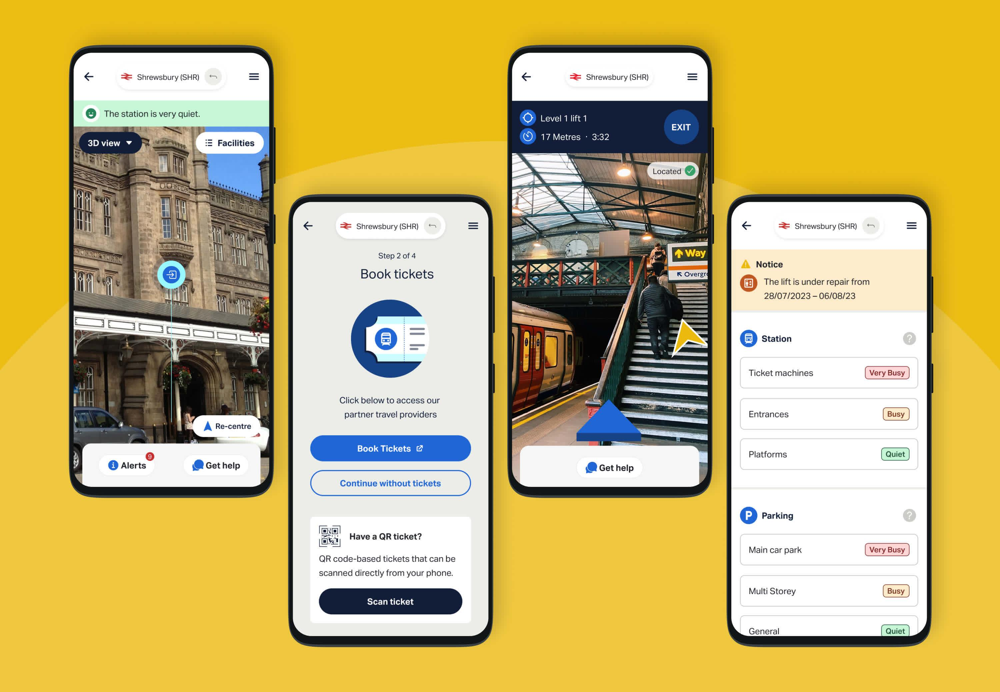

# Smart India Hackathon Workshop
# Date: 26.10.2026
## Register Number: 212225040092
## Name: GAYATHRI C 
## Problem Title
SIH 1710: Enhancing Navigation for Railway Station Facilities and Locations
## Problem Description
Background: Railway stations are complex environments with numerous facilities and locations such as ticket counters, platforms, restrooms, food courts, and waiting areas. Passengers often face difficulties in navigating these spaces, especially in large or unfamiliar stations. Efficient and user-friendly navigation systems are crucial for improving passenger experience, reducing congestion, and ensuring timely travel connections. 
Description: The problem involves developing a comprehensive navigation solution for railway stations that assists passengers in locating various facilities and destinations within the station premises. This includes creating detailed maps, providing real-time directions, and integrating features such as accessibility options for individuals with disabilities. The solution should be intuitive, easy to use, and accessible via multiple platforms, including mobile devices and digital kiosks. Key challenges include updating navigation information in real-time, ensuring accuracy, and accommodating the diverse needs of all passengers.
Expected Solution: The expected solution is a multi-platform navigation system that provides detailed, real-time directions to all facilities and locations within a railway station. This system should include: A mobile application with 3D interactive maps and step-by-step navigation. Digital kiosks located throughout the station with touch-screen interfaces. Voice-guided navigation for visually impaired passengers. Regular updates to reflect changes in station layout and facility locations. Integration with existing railway apps and services for seamless user experience. The solution should enhance the overall passenger experience by reducing confusion, saving time, and improving accessibility within the station.

## Problem Creater's Organization
Ministry of Railway

## Idea
RailGuide is a multi-platform navigation system that helps passengers find platforms, ticket counters, restrooms, food courts, waiting areas and other station facilities through a mobile application, website and digital kiosks.

Passengers can select their starting point and destination to view an enlarged interactive station map with step-by-step directions, walking distance, estimated time, platform details and interchange points. The system provides real-time route updates, notifications, voice-guided navigation, accessible routes, offline maps, passenger assistance, food services and feedback management.

## Proposed Solution / Architecture Diagram
```
Interactive Navigation: Detailed 2D/3D maps with From–To selection and step-by-step indoor directions.

Real-Time Updates: Instant alerts and automatic rerouting for platform changes, facility closures and diversions.

Smart Notifications: Opening pop-ups, notification sidebar and device push notifications.

Accessible Navigation: Voice guidance, multilingual support, screen-reader compatibility and wheelchair-friendly routes.

Offline Support: Downloadable station maps, QR-based location identification and essential navigation without internet access.

Passenger Assistance: Mapped help desks, staff assistance requests and emergency information.

Food Services: Food outlet discovery, online ordering where supported and offline menus.

Feedback Management: Passenger complaints, suggestions, issue tracking and an administrator dashboard.
```


## Sample Website Interface 

## Use Cases

```
Platform Navigation: Guide passengers from the entrance to their required platform.

Facility Locator: Find ticket counters, restrooms, food courts, lifts and waiting areas.

Route Updates: Recalculate routes when platforms, passages or facilities change.

Live Notifications: Alert passengers about diversions, closures and important announcements.

Accessibility: Provide voice guidance and wheelchair-friendly routes.

Offline Navigation: Access downloaded maps and essential facility information.

Food Booking: Find food outlets and order through supported services.

Passenger Assistance: Connect passengers with station staff and help desks.

Feedback System: Collect complaints and track resolutions through an admin dashboard.
```

## Technology Stack
```
 Mobile Application – React Native
 Website & Digital Kiosk – React.js, Vite
 UI Design – Tailwind CSS / Material UI
 Interactive 2D Maps – MapLibre GL JS
 3D Maps – Three.js
 Backend – Node.js, Express.js
 Database – PostgreSQL, PostGIS
 Real-Time Updates – Socket.IO
 Push Notifications – Firebase Cloud Messaging (FCM)
 Indoor Navigation – QR Codes, BLE Beacons
 Route Calculation – Dijkstra’s Algorithm 
 Voice Navigation – Text-to-Speech (TTS) APIs
 Offline Support – IndexedDB, Service Workers
Authentication & Security – JWT, Role-Based Access Control (RBAC)
Deployment – Docker, Cloud Hosting
```
## Dependencies
```
Accurate railway station maps and facility information.
Authorized railway APIs for platform and operational updates.
QR codes or indoor positioning infrastructure.
Reliable network connectivity and offline data storage.
Cooperation from station authorities and assistance staff.
Food vendor integration for online ordering.
Security, privacy and accessibility testing.
Regular map maintenance and verification of route changes.
```

## Conclusion 

RailGuide is a smart, accessible, and user-friendly navigation system that helps passengers navigate railway stations easily. It provides interactive maps, real-time route updates, voice guidance, and instant notifications. Offline support and passenger assistance ensure a smooth experience even during network issues. Food services and feedback management further improve passenger convenience. Overall, RailGuide aims to make railway stations safer, more efficient, and easier to navigate for everyone.